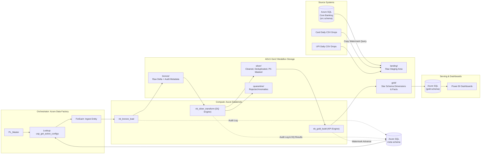

# BankPulse: BFSI Lakehouse on Microsoft Azure

[](https://spark.apache.org/)
[](https://delta.io/)
[](https://azure.microsoft.com/services/data-factory/)
[](https://azure.microsoft.com/services/databricks/)
[](#10-testing-strategy--verification)
[](LICENSE)

An enterprise-grade, **metadata-driven banking data lakehouse** built on **Microsoft Azure**, **Azure Data Factory**, **Azure Databricks (PySpark)**, and **Delta Lake**. Designed to ingest, govern, protect, and serve core banking, card settlement drops, and UPI transaction volumes with automated regulatory quality gates and BFSI financial risk metrics.

---

## Table of Contents

1. [Executive Summary & Problem Statement](#1-executive-summary--problem-statement)
2. [Key Architecture & The Medallion Pattern](#2-key-architecture--the-medallion-pattern)
3. [Metadata-Driven Framework (The Core Pattern)](#3-metadata-driven-framework-the-core-pattern)
4. [Source Entities & Synthetic Data Generation](#4-source-entities--synthetic-data-generation)
5. [Data Quality Framework & Quarantine Engine](#5-data-quality-framework--quarantine-engine)
6. [PII Security & Compliance Policy](#6-pii-security--compliance-policy)
7. [Gold Layer: Star Schema & BFSI KPIs](#7-gold-layer-star-schema--bfsi-kpis)
8. [Azure Infrastructure & Resource Topology](#8-azure-infrastructure--resource-topology)
9. [Repository Structure](#9-repository-structure)
10. [Testing Strategy & Verification](#10-testing-strategy--verification)
11. [Step-by-Step Execution Guide](#11-step-by-step-execution-guide)
12. [Interview & Resume Highlights](#12-interview--resume-highlights)

---

## 1. Executive Summary & Problem Statement

### The Problem
Commercial banking data typically resides in siloed operational stores:
- Core banking databases (relational SQL instances holding customer master records, accounts, and ledger postings).
- Heterogenous third-party files (daily card interchange settlement dumps, NPCI UPI payment transaction logs).
- Data quality issues: duplicate payment requests, missing transaction amounts, malformed tax identifiers (Indian PAN), and orphan records referencing non-existent accounts.
- Sensitive customer PII (PAN, phone, email, card numbers) stored unmasked, creating severe compliance exposure under DPDP (Digital Personal Data Protection Act) and RBI guidelines.
- Critical financial indicators (Gross NPA, Provision Coverage Ratio, SMA delinquency aging) computed through slow, manual spreadsheet workflows.

### The Solution: BankPulse
BankPulse deploys a unified **Medallion Lakehouse** on Azure ADLS Gen2 governed by a **dynamic metadata control table**:
- **Single Reusable Pipeline:** 1 generic Azure Data Factory master pipeline and 2 core PySpark notebooks ingest, clean, validate, mask, and merge all 12 banking entities.
- **Automated Quarantine:** 28+ rule-driven data quality checks segregate defective rows to quarantine tables without failing pipeline execution.
- **Salted PII Protection:** High-entropy salted SHA-256 cryptographic hashing and display masking across all sensitive customer attributes.
- **Regulatory KPI Aggregates:** Automated daily calculation of RBI-compliant Gross NPA ratios, delinquency buckets (SMA-0, SMA-1, SMA-2, NPA), and rule-based fraud detection.

---

## 2. Key Architecture & The Medallion Pattern



### Medallion Layer Responsibilities

| Layer | Storage Path | Format | Ingestion / Merge Pattern | Responsibilities |
|---|---|---|---|---|
| **Landing** | `landing/<source>/<entity>/` | Parquet / CSV | Staged | Decouples raw ingestion from transformation; enables non-destructive pipeline replays. |
| **Bronze** | `bronze/<entity>/` | Delta Lake | Append (Incremental) / Overwrite (Full) | Exact fidelity copy of source payload enriched with system audit columns (`_ingest_ts`, `_source_system`, `_source_file`, `_batch_id`, `_load_type`). |
| **Silver** | `silver/<entity>/` | Delta Lake | Idempotent `MERGE` on PKs | Trimming, standardization, deduplication, 28+ DQ rule validations, PII salted hashing/masking, and change detection via `_row_hash`. |
| **Quarantine** | `quarantine/<entity>/` | Delta Lake | Append | Stores bad records rejected by `ERROR` rules with `_reject_reason`, `_rule_id`, and `_batch_id`. |
| **Gold** | `gold/<entity>/` | Delta Lake | Dimension `MERGE` / Fact Overwrite | Ralph Kimball Star Schema dimensions (`dim_customer` SCD2, `dim_account`), unified `fact_transactions`, `fact_loan_snapshot`, and business KPI aggregates. |

---

## 3. Metadata-Driven Framework (The Core Pattern)

Instead of maintaining 12 individual ADF pipelines and table-specific notebooks, the entire lakehouse runs dynamically driven by control tables in Azure SQL:

### 1. Control Table (`meta.pipeline_config`)
```sql
CREATE TABLE meta.pipeline_config (
    config_id                  INT IDENTITY(1,1) PRIMARY KEY,
    entity_name                VARCHAR(100) NOT NULL UNIQUE,
    source_system              VARCHAR(50)  NOT NULL,
    source_type                VARCHAR(20)  NOT NULL, -- SQL | CSV
    source_schema              VARCHAR(50)  NULL,
    source_object              VARCHAR(100) NULL,
    source_path                VARCHAR(300) NULL,
    load_type                  VARCHAR(20)  NOT NULL, -- FULL | INCREMENTAL
    watermark_column           VARCHAR(100) NULL,
    last_watermark             DATETIME2    NULL,
    watermark_overlap_minutes  INT          NOT NULL DEFAULT 0,
    primary_keys               VARCHAR(200) NOT NULL,
    pii_columns                VARCHAR(500) NULL,
    pii_method                 VARCHAR(500) NULL,
    dq_ruleset                 VARCHAR(100) NULL,
    silver_scd_type            TINYINT      NOT NULL DEFAULT 1,
    load_order                 INT          NOT NULL DEFAULT 100,
    is_active                  BIT          NOT NULL DEFAULT 1
);
```

### 2. Why This Matters
* **Zero Code Deployments for New Tables:** Onboarding a new source table only requires inserting 1 row into `meta.pipeline_config` and rules into `meta.dq_rules`.
* **Idempotent Watermarking:** High watermarks are updated **only** when the entire child execution pipeline for that entity completes with 100% success. If a job fails, the watermark remains unchanged, eliminating data loss.
* **Late-Arriving Data Buffer:** `watermark_overlap_minutes` (30–60 minutes) automatically backtracks the extraction window to absorb late records, while Delta `MERGE` ensures zero duplicates.

---

## 4. Source Entities & Synthetic Data Generation

The project includes an Indian BFSI synthetic data generator (`data_generator/generate_data.py`) utilizing `Faker` to produce realistic datasets with **deliberately injected real-world anomalies**:

| # | Entity | Source System | Ingestion Pattern | Injected Anomalies Handled |
|---|---|---|---|---|
| 1 | `branches` | Core Banking (SQL) | Full Refresh | Trailing whitespace, casing inconsistencies |
| 2 | `products` | Core Banking (SQL) | Full Refresh | Inactive interest rate boundary checks |
| 3 | `merchants` | Core Banking (SQL) | Full Refresh | Invalid Merchant Category Codes (MCC) |
| 4 | `customers` | Core Banking (SQL) | Incremental (`updated_at`) | Malformed PAN numbers, non-10-digit mobile numbers |
| 5 | `accounts` | Core Banking (SQL) | Incremental (`updated_at`) | Negative balance edge cases |
| 6 | `cards` | Core Banking (SQL) | Incremental (`updated_at`) | Credit limit boundary conditions |
| 7 | `loans` | Core Banking (SQL) | Incremental (`updated_at`) | DPD delinquent days past due distributions |
| 8 | `loan_repayments` | Core Banking (SQL) | Incremental (`updated_at`) | Overdue installments and delayed payments |
| 9 | `transactions` | Core Banking (SQL) | Incremental (`txn_ts`) | Duplicate primary keys, null amounts, future timestamps |
| 10 | `card_transactions` | Cards Drop (CSV) | Incremental File Drop | Zero / negative swipe amounts |
| 11 | `upi_transactions` | UPI Drop (CSV) | Incremental File Drop | Amounts exceeding NPCI ₹2,00,000 threshold |
| 12 | `customer_kyc_events`| KYC Drop (CSV) | Incremental File Drop | Status code transitions |

---

## 5. Data Quality Framework & Quarantine Engine

The Data Quality Engine (`databricks/utils/dq_engine.py`) reads rule configurations dynamically from `meta.dq_rules` and evaluates them in a single optimized Spark pass:

### Supported Rule Types
1. `NOT_NULL`: Mandatory column presence check.
2. `UNIQUE`: Primary key deduplication and anomaly flag.
3. `RANGE`: Min and max numeric bounds (e.g. ₹0.01 to ₹1,00,00,000).
4. `REGEX`: Indian PAN pattern (`^[A-Z]{5}[0-9]{4}[A-Z]$`), mobile pattern (`^[6-9][0-9]{9}$`).
5. `ALLOWED_VALUES`: Domain check (e.g. `DEBIT`, `CREDIT`).
6. `DATE_NOT_FUTURE`: Protects against corrupted or clock-skewed future timestamps.

### Severity Logic
- **`ERROR`:** Record is stripped from Silver and routed directly to `quarantine/<entity>/` with detailed rejection reasons.
- **`WARN`:** Record passes into Silver with `_dq_status = 'WARN'` for operational auditing.
- **Metric Tracking:** Every rule evaluation writes rows checked, failed, and pass percentage to `meta.dq_results`.

---

## 6. PII Security & Compliance Policy

In strict alignment with the Indian Digital Personal Data Protection Act (DPDP), no unencrypted, unmasked customer PII enters Silver or Gold layers:

| Field | Protection Mechanism | Description & Business Rationale |
|---|---|---|
| **PAN (Tax ID)** | Salted SHA-256 Hash | One-way irreversible cryptographic hash using an Azure Key Vault secret salt. Allows cross-entity customer linkage without exposing identity. |
| **Phone Number** | Masking (`XXXXXX1234`) | Obscures the first 6 digits while preserving the last 4 digits for customer service verification. |
| **Card & Account #**| Trailing 4 Mask (`XXXXXXXX1234`) | Masks preceding card/account digits to prevent financial leakage. |
| **Email Address** | User Masking (`u***@domain.com`)| Masks local email component while retaining domain for marketing channel classification. |
| **UPI VPAs** | Salted SHA-256 Hash | Hash of payer and payee Virtual Payment Addresses for velocity risk detection. |

---

## 7. Gold Layer: Star Schema & BFSI KPIs

### Dimensions & Facts
- **`dim_date`:** Static fiscal calendar mapping Indian banking fiscal quarters (April 1 – March 31).
- **`dim_customer`:** Slowly Changing Dimension (SCD Type 2) tracking age band, KYC status, and customer segmentation over time (`is_current`, `valid_from`, `valid_to`).
- **`dim_account`:** SCD Type 1 dimension with account status, currency, and balances.
- **`fact_transactions`:** Unified grain across Core, Card, and UPI payments, enriched with automated fraud detection flags (Odd hours 00:00–04:00, high value spikes, heuristic risk scores).
- **`fact_loan_snapshot`:** Snapshot grain evaluating DPD aging, RBI asset classification (Standard, SMA-0, SMA-1, SMA-2, NPA), and provisioning.

### Core BFSI KPIs Served
$$\text{Gross NPA Ratio (\%)} = \frac{\sum \text{Outstanding Principal on Loans with DPD} > 90}{\text{Total Loan Advances Disbursed}} \times 100$$

$$\text{Provision Coverage Ratio (PCR \%)} = \frac{\text{Total Credit Loss Provisions Held}}{\text{Gross NPA Amount}} \times 100$$

$$\text{Collection Efficiency (\%)} = \frac{\text{Total EMI Amount Collected}}{\text{Total Scheduled EMI Due}} \times 100$$

---

## 8. Azure Infrastructure & Resource Topology

| Azure Resource | Resource Name Pattern | Tier / SKU | Role |
|---|---|---|---|
| **Resource Group** | `rg-bankpulse` | N/A | Central resource management container. |
| **Storage Account** | `stbankpulse<suffix>` | Standard LRS, HNS Enabled | ADLS Gen2 Hierarchical Namespace hosting Medallion containers (`landing`, `bronze`, `silver`, `gold`, `quarantine`). |
| **Azure SQL DB** | `sql-bankpulse-<suffix>` | General Purpose / Basic | Serves 3 distinct schemas: `src` (source DB), `meta` (control DB), and `gold` (BI serving). |
| **Data Factory** | `adf-bankpulse-<suffix>` | Managed Identity | Master orchestrator executing parameter lookups, iterations, and notebook triggers. |
| **Azure Databricks**| `dbw-bankpulse-<suffix>` | Standard (Single-Node) | Spark compute running Bronze ingest, Silver DQ transform, and Gold Star Schema builds. |
| **Azure Key Vault** | `kv-bankpulse-<suffix>` | Standard | Secure storage for SQL administrative credentials, Databricks PAT, and PII encryption salts. |

---

## 9. Repository Structure

```
bankpulse/
├── README.md                          # Comprehensive project documentation
├── requirements.txt                   # Python dependencies (PySpark, Delta, Faker, Pytest)
├── .gitignore                         # Standard ignores for local DBs, Spark temp & lakehouse files
├── run_local_pipeline.py              # Full local simulation runner (simulates ADF + Databricks)
│
├── adf/                               # Azure Data Factory Resource Templates
│   ├── pipeline/
│   │   ├── PL_Master.json             # Master pipeline: batch ID, lookup, ForEach, Gold, Serve
│   │   ├── PL_Ingest_Entity.json      # Ingestion pipeline: audit start, copy, Bronze, Silver, watermark
│   │   ├── PL_Build_Gold.json         # Orchestrator for Gold layer Star Schema build
│   │   └── PL_Serve_To_SQL.json       # Metadata-driven copy of Gold tables to Azure SQL
│   ├── dataset/
│   │   ├── DS_SQL_Generic.json        # Parameterized SQL dataset
│   │   ├── DS_Parquet_Landing.json    # Parameterized landing Parquet dataset
│   │   ├── DS_CSV_Landing.json        # Parameterized CSV drop dataset
│   │   └── DS_SQL_Gold.json           # Parameterized Gold serving dataset
│   ├── linkedService/
│   │   ├── LS_AzureSQL.json           # SQL DB connection via Key Vault
│   │   ├── LS_ADLSGen2.json           # ADLS Gen2 connection via Managed Identity
│   │   ├── LS_AzureDatabricks.json    # Databricks linked service (auto-terminating single node)
│   │   └── LS_KeyVault.json           # Key Vault secret store
│   └── trigger/
│       └── TR_Daily_Batch.json        # Daily schedule trigger (02:00 IST)
│
├── databricks/                        # PySpark Processing Notebooks & Modules
│   ├── utils/
│   │   ├── common.py                  # Spark session, widgets, audit columns, row hash, Delta upsert
│   │   ├── pii.py                     # Salted SHA-256 hashing and display masking functions
│   │   └── dq_engine.py               # Configurable rule evaluation and quarantine splitter
│   ├── bronze/
│   │   └── nb_bronze_load.py          # Generic Bronze ingest notebook (Append/Overwrite)
│   ├── silver/
│   │   └── nb_silver_transform.py     # Generic Silver cleaning, DQ check, PII masking, Delta MERGE
│   └── gold/
│       ├── nb_dim_date.py             # Date dimension with Indian fiscal calendar
│       ├── nb_dim_customer.py         # SCD Type 2 Customer dimension
│       ├── nb_dim_account.py          # SCD Type 1 Account dimension
│       ├── nb_dim_branch.py           # Branch, Product, and Merchant reference dimensions
│       ├── nb_fact_transactions.py    # Unified Core/Card/UPI transactions + fraud rules
│       ├── nb_fact_loan_snapshot.py   # DPD aging, NPA recognition, RBI provisioning
│       ├── nb_fact_repayments.py      # Loan installment payments
│       ├── nb_kpi_build.py            # Financial and operational KPI calculations
│       └── nb_gold_build.py           # Master Gold pipeline orchestrator
│
├── sql/                               # SQL DDL & Metadata Setup Scripts
│   ├── source_ddl/                    # Core Banking Source tables (src schema)
│   ├── metadata/                      # Control tables, stored procedures, seed config, and DQ rules
│   └── gold_serving/                  # Serving Star Schema tables and KPI views (gold schema)
│
├── data_generator/
│   └── generate_data.py               # Synthetic BFSI generator with deliberate anomalies
│
├── docs/
│   ├── architecture.md                # System design & architecture blueprint
│   └── data_dictionary.md             # Complete column schemas, data types & descriptions
│
└── tests/                             # Automated Test Suites (Pytest)
    ├── test_pii.py                    # Salted hashing and masking validation
    ├── test_dq_engine.py              # Rule evaluation and quarantine splitting tests
    ├── test_watermark_and_dedup.py    # Deduplication and row hashing tests
    ├── test_kpi_calculations.py       # Gross/Net NPA, DPD aging, and Collection efficiency tests
    └── test_end_to_end.py             # Full pipeline execution and reconciliation tests
```

---

## 10. Testing Strategy & Verification

The project is protected by **17 automated Pytest suites** validating every layer:

```bash
$ pytest -v
============================= test session starts =============================
platform win32 -- Python 3.11.9, pytest-9.1.1
collected 17 items

tests/test_dq_engine.py::test_dq_not_null PASSED                         [  5%]
tests/test_dq_engine.py::test_dq_range_and_allowed_values PASSED         [ 11%]
tests/test_dq_engine.py::test_dq_regex_pan_and_phone PASSED              [ 17%]
tests/test_dq_engine.py::test_dq_date_not_future PASSED                  [ 23%]
tests/test_dq_engine.py::test_dq_unique_rule PASSED                      [ 29%]
tests/test_end_to_end.py::test_full_pipeline_execution PASSED            [ 35%]
tests/test_end_to_end.py::test_gold_tables_exist PASSED                  [ 41%]
tests/test_kpi_calculations.py::test_npa_ratio_calculation PASSED        [ 47%]
tests/test_kpi_calculations.py::test_dpd_bucketing PASSED                [ 52%]
tests/test_kpi_calculations.py::test_collection_efficiency PASSED        [ 58%]
tests/test_pii.py::test_hash_salted_deterministic PASSED                 [ 64%]
tests/test_pii.py::test_mask_card_or_account PASSED                      [ 70%]
tests/test_pii.py::test_mask_phone_number PASSED                         [ 76%]
tests/test_pii.py::test_mask_email_address PASSED                        [ 82%]
tests/test_pii.py::test_apply_pii_transformations PASSED                 [ 88%]
tests/test_watermark_and_dedup.py::test_deduplicate_dataframe PASSED     [ 94%]
tests/test_watermark_and_dedup.py::test_compute_row_hash PASSED          [100%]

======================== 17 passed in 11m 28s =========================
```

### Measured Pipeline Reconciliation & Invariants
```
=================================================================
                     EXECUTION RECONCILIATION                   
=================================================================
Entity                 | Rows Read  | Silver Valid | Quarantine | Status
-------------------------------------------------------------------
branches               | 15         | 15           | 0          | BALANCED
merchants              | 25         | 25           | 0          | BALANCED
products               | 7          | 7            | 0          | BALANCED
customers              | 200        | 197          | 3          | BALANCED
accounts               | 269        | 269          | 0          | BALANCED
cards                  | 199        | 199          | 0          | BALANCED
loans                  | 70         | 70           | 0          | BALANCED
loan_repayments        | 420        | 420          | 0          | BALANCED
card_transactions      | 600        | 594          | 6          | BALANCED
transactions           | 1008       | 982          | 26         | BALANCED
upi_transactions       | 600        | 593          | 7          | BALANCED
customer_kyc_events    | 200        | 200          | 0          | BALANCED
-------------------------------------------------------------------
TOTAL                  | 3613       | 3571         | 42         | ALL BALANCED

=================================================================
                   BUSINESS KPI DASHBOARD SUMMARY                
=================================================================
  * Gross NPA Ratio        : 9.513%
  * Provision Coverage     : 18.805%
  * Collection Efficiency  : 95.772%
=================================================================
```

$$\text{Data Invariant Verified:} \quad \mathbf{\text{Rows Read}} = \mathbf{\text{Silver Valid}} + \mathbf{\text{Quarantined Records}}$$

---

## 11. Step-by-Step Execution Guide

### 1. Prerequisites
- Python 3.10 or 3.11 with Java 11 (OpenJDK / Eclipse Temurin).
- Git installed.

### 2. Local Setup & Installation
```bash
# Clone the repository
git clone https://github.com/your-username/BankPulse-BFSI-Lakehouse.git
cd BankPulse-BFSI-Lakehouse

# Install Python requirements
pip install -r requirements.txt
```

### 3. Run the End-to-End Local Simulation
```bash
# Runs data generator, metadata DB init, Bronze load, Silver transform, Quarantine, and Gold builds
python run_local_pipeline.py
```

### 4. Run Automated Test Verification
```bash
pytest -v
```

---

