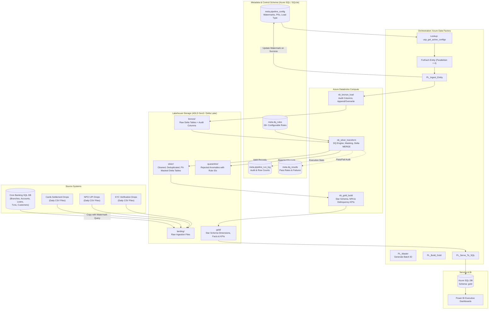

# BankPulse: Architectural Blueprint & System Design

## 1. Executive Summary

BankPulse is an enterprise-grade lakehouse data platform engineered for mid-sized commercial banking operations in India. It ingests heterogenous transaction streams (Core Banking SQL Server, daily Card settlement drops, and NPCI UPI batch logs), enforces rigorous regulatory data quality validations, quarantines anomalies, applies pseudonymization / tokenization on sensitive customer PII, and models a Star Schema serving Gold layer powering executive dashboards.

The platform is designed around a **Metadata-Driven Pipeline Framework**:
- A single master Azure Data Factory pipeline (`PL_Master`) ingests and processes all 12 banking entities.
- Data ingestion, watermarking, schema rules, and PII masking policies are completely configured in control tables (`meta.pipeline_config`, `meta.dq_rules`).
- Adding a new table or modifying a validation threshold requires zero code changes or deployment pipelines—only an INSERT or UPDATE statement in the metadata database.

---

## 2. End-to-End Architecture Diagram

---

## 3. The 12 Banking Entities

| # | Entity Name | Category | Source Format | Load Pattern | Watermark Column | PII Masking Method |
|---|---|---|---|---|---|---|
| 1 | `branches` | Reference | SQL | FULL | None | None |
| 2 | `products` | Reference | SQL | FULL | None | None |
| 3 | `merchants` | Reference | SQL | FULL | None | None |
| 4 | `customers` | Master | SQL | INCREMENTAL | `updated_at` | PAN: HASH (Salted), Phone: MASK, Email: MASK |
| 5 | `accounts` | Master | SQL | INCREMENTAL | `updated_at` | Account Number: MASK (keep last 4) |
| 6 | `cards` | Master | SQL | INCREMENTAL | `updated_at` | Card Number: MASK (keep last 4) |
| 7 | `loans` | Master | SQL | INCREMENTAL | `updated_at` | None |
| 8 | `loan_repayments` | Transaction | SQL | INCREMENTAL | `updated_at` | None |
| 9 | `transactions` | Transaction | SQL | INCREMENTAL | `txn_ts` | None |
| 10 | `card_transactions` | Transaction | CSV Drop | INCREMENTAL | `txn_ts` | Card Number: MASK |
| 11 | `upi_transactions` | Transaction | CSV Drop | INCREMENTAL | `txn_ts` | Payer VPA: HASH, Payee VPA: HASH |
| 12 | `customer_kyc_events` | Event | CSV Drop | INCREMENTAL | `event_ts` | PAN: HASH |

---

## 4. Medallion Layer Design Specifications

### 4.1 Landing Zone (`landing/`)
- Staging area separating extraction from transformation.
- Core Banking tables are extracted into Parquet format via ADF Copy activity.
- Card and UPI files land in partitioned folder structure: `landing/<source_system>/<entity>/load_date=YYYY-MM-DD/`.

### 4.2 Bronze Layer (`bronze/`)
- Format: Delta Lake.
- Ingestion mode: `Append` for transactional/incremental entities; `Overwrite` for reference tables.
- Preserves raw input exactly as received.
- Audit columns enriched:
  - `_ingest_ts`: UTC timestamp of ingestion.
  - `_source_system`: Identifying source (e.g. `CORE_BANKING`, `UPI_FILE`).
  - `_source_file`: Path of the origin file.
  - `_batch_id`: Unique ADF execution batch identifier.
  - `_load_type`: `INCREMENTAL` or `FULL`.

### 4.3 Silver Layer (`silver/` and `quarantine/`)
- Format: Delta Lake.
- Cleaning & Standardization: Trims whitespace, standardizes case, normalizes date formats.
- Deduplication: Window function partitioning by primary key and ordering by watermark descending.
- Rule-based Data Quality Engine: 28+ validation checks evaluated dynamically from `meta.dq_rules`.
- Quarantine: Rejected records failing `ERROR` rules are routed to `quarantine/<entity>/` with `_reject_reason`, `_rule_id`, and `_batch_id`.
- PII Protection: Sensitive attributes pseudonymized using SHA-256 with secret salt, or masked retaining the trailing 4 digits.
- Idempotency: `MERGE` upsert into Delta table matching on primary keys and updating when `_row_hash` differs.

### 4.4 Gold Layer (`gold/`)
- Modeled as a Ralph Kimball Star Schema:
  - Dimensions: `dim_customer` (SCD Type 2), `dim_account` (SCD Type 1), `dim_branch`, `dim_product`, `dim_merchant`, `dim_date` (Indian Fiscal Calendar).
  - Facts: `fact_transactions` (unified Core, Card, and UPI with rule-based fraud detection), `fact_loan_snapshot` (DPD aging, Gross NPA recognition, RBI provisioning), `fact_repayments`.
  - KPI Aggregates: `kpi_npa_metrics`, `kpi_delinquency_buckets`, `kpi_channel_performance`, `kpi_fraud_monitoring`, `kpi_branch_performance`, `kpi_collection_efficiency`.

---

## 5. Security & Governance

1. **Zero Secret Footprint**: No database credentials, API keys, or storage tokens exist in source code. All secrets are stored in Azure Key Vault and injected dynamically into Databricks secret scopes and ADF Linked Services.
2. **Salted Hashing**: Customer PAN and UPI VPAs are hashed using SHA-256 with a high-entropy salt retrieved from Key Vault. This guarantees irreversibility while maintaining joinability for fraud detection.
3. **Display Masking**: Account numbers, card numbers, phone numbers, and email addresses are masked in the Silver layer, preventing plain text exposure in downstream Gold tables and BI dashboards.
